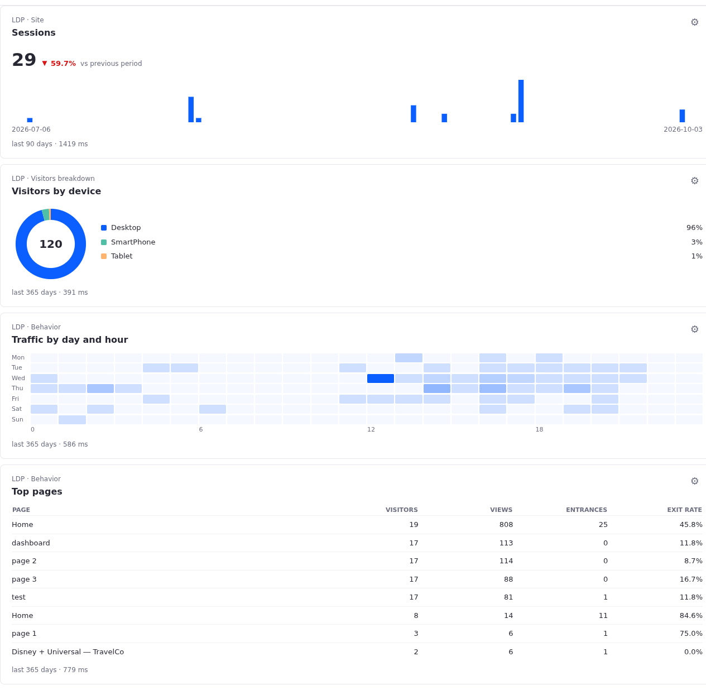
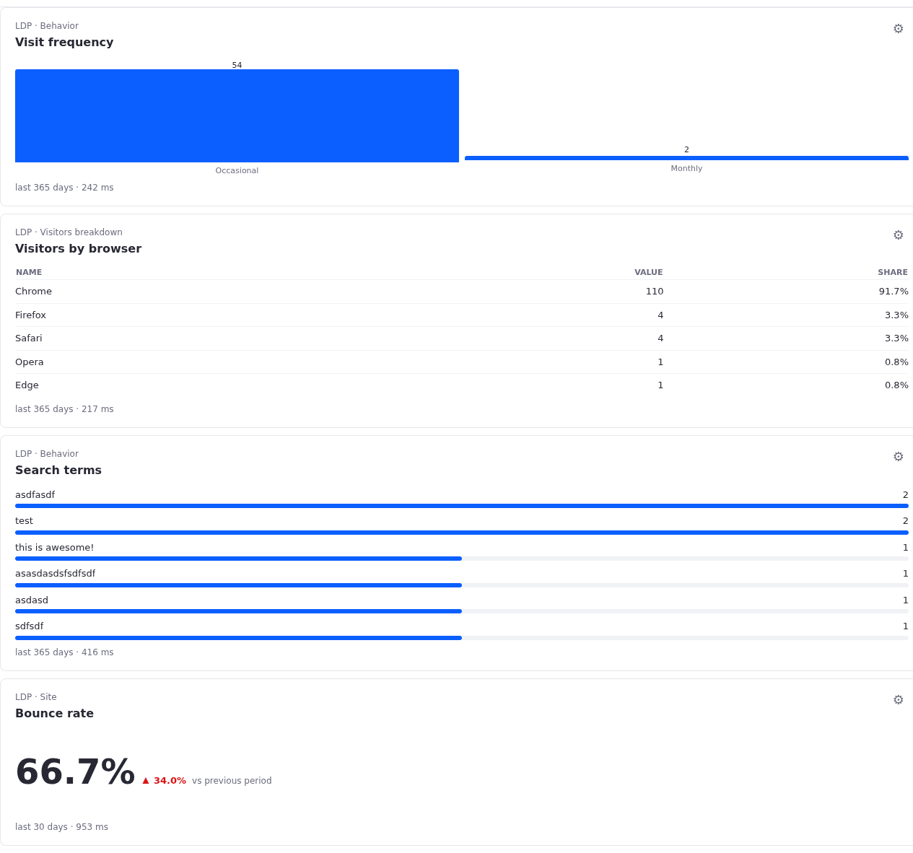
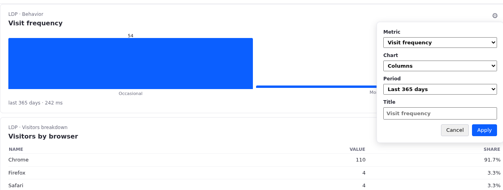

# LDP Metric Card

A Custom Element client extension (`ldp-metric-card`) that renders any of 21 LDP metrics, each with a choice of charts, through the DXP GraphQL proxy at `POST /o/analytics-rest/v1.0/graphql`. Each card on a page has a cog that opens a panel to pick the metric, the chart, the period, and the title.





## Configuration Is Not Persisted Yet

The cog's configuration lives only in the card's memory. Reloading or publishing the page resets every card to *Visitors, last 30 days*. Persistence comes next, with Liferay Objects. The configuration is already a single object per card (`metric`, `chart`, `range`, `title`), in the shape the Object will store.



## Metrics and Charts

Every entry of the catalog in `ldp-metric-card.js` builds its own query, extracts its result, formats the value, and declares the shape of its data. Each shape offers its own charts; the panel lists only the charts that fit the selected metric. Adding a metric means adding an entry.

| Group | Metrics | Query | Shape | Charts |
|---|---|---|---|---|
| Site | Visitors, sessions, anonymous visitors, known visitors, bounce rate, session duration, sessions per visitor | `site { <metric> }` | Series | Area, line, daily columns, number only |
| Individuals | Total, known, and anonymous individuals | `individualMetric { <metric> }` | Series | Area, line, daily columns, number only |
| Acquisition | By channel, by referrer, by source / medium | `acquisitions` | Items | Horizontal bars, columns, donut, table |
| Behavior | Search terms, site interests, visit frequency | `searchTerms`, `siteInterests`, `visitFrequency` | Items | Horizontal bars, columns, donut, table |
| Behavior | Traffic by day and hour | `siteVisitorHeatMap` | Grid | Heatmap |
| Behavior | Top pages | `pages` | Pages | Table (visitors, views, entrances, exit rate), horizontal bars |
| Visitors breakdown | By device, browser, and country | `site { visitorsMetric { device \| browser \| geolocation } }` | Items | Horizontal bars, columns, donut, table |

The chart types and the search terms, visit frequency, heatmap, and top pages queries take after the `analytics-cloud-charts` workspace (interaminense/liferay-portal#457). The charts here are plain SVG and HTML, with no chart library.

What the live check against LDP showed:

- `bounceRateMetric` is a fraction (`0.67`), and `sessionDurationMetric` is in milliseconds.
- `trend.trendClassification` already accounts for the metric's direction: a rising bounce rate comes back as `NEGATIVE`. The card colors the trend by that classification, not by its sign.
- `individualMetric` accepts `rangeKey` only, so the panel disables the custom range for individual metrics.
- The heatmap's `colDimension` is the day of the week, with `0` for Sunday, and its `rowDimension` is the hour, in UTC.
- Individual metrics can take around 10 s on LDP's cold cache, past the proxy's timeout, which then answers 502. The card retries once; the second attempt usually takes under a second.

`scripts/probe-metrics.mjs` runs the whole catalog against a DXP and prints what each metric returns.

## Run

1. Serve this folder:

	```bash
	python3 -m http.server 3334 --bind 127.0.0.1
	```

1. In DXP, go to *Applications → Client Extensions → New → Add Custom Element*:

	| Field | Value |
	|---|---|
	| Name | `LDP Metric Card` |
	| HTML Element Name | `ldp-metric-card` |
	| JavaScript URL | `http://localhost:3334/ldp-metric-card.js` |
	| Instanceable | checked |

1. On a content page, drag *Client Extensions → LDP Metric Card* onto the page as many times as needed and publish. Use the cog on each card to configure it.

## Behavior

- The LDP property (channel) is discovered once per page from the current site.
- Identical queries are cached per page: four cards with the same metric make one request.
- The cog shows for signed-in users only.
- Errors are spelled out: DXP not connected to LDP, site not assigned to a property, GraphQL errors, and empty periods.
