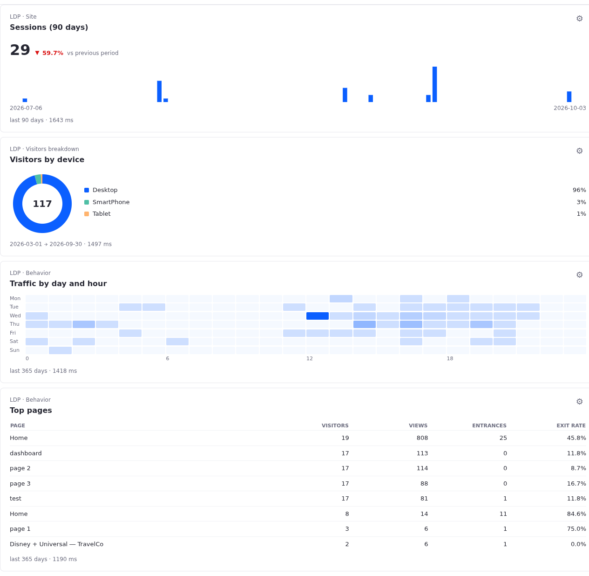

# Persisting the Metric Card with Liferay Objects

`ldp-metric-card` keeps the configuration of each card (metric, chart, period, and title) in a Liferay Object, so a dashboard survives page reloads and republishing. The Object is the card's only storage: there is no backend, no `localStorage`, and no custom API. The card talks to the headless API that Objects generates for every definition.



## How It Fits Together

| Piece | Where |
|---|---|
| Object definition `LDPMetricCard` | `ldp-metric-card.object-definition.json`, created by `create-object-definition.sh` inside the *DEVCON 2026* object folder |
| Generated headless API | `/o/c/ldpmetriccards` |
| One entry per card | Keyed by its external reference code (ERC) |
| Card code | `loadConfig`, `saveConfig`, and `getInstanceKey` in `../client-extension-metric-card/ldp-metric-card.js` |

### The Key of Each Card

Every widget instance on a page lives inside a portlet wrapper whose id DXP generates once per instance, for example:

```
p_p_id_com_liferay_client_extension_web_internal_portlet_ClientExtensionEntryPortlet_37042523845272_a23b752b_e2f9_8468_811c_355ea1ff07d4_INSTANCE_ltzu_
```

The card strips the `p_p_id_` prefix and the trailing `_`, and uses the rest as the ERC of its entry:

```js
function getInstanceKey(element) {
	const wrapper = element.closest('[id^="p_p_id_"]');

	return wrapper?.id.match(/^p_p_id_(.+)_$/)?.[1] || null;
}
```

The id is the same in the page editor (the draft layout) and on the published page, even though the two have different `plid`s. That is why the key must not include the `plid`.

### Load and Save

With the ERC as the key, the card needs no search and no bookkeeping of entry ids:

| Moment | Call | Outcome |
|---|---|---|
| The card connects | `GET /o/c/ldpmetriccards/by-external-reference-code/{key}` | `200` → use the stored configuration. `404` → the card was never configured; use the default (*Visitors, last 30 days*). |
| *Apply* in the cog's panel | `PUT /o/c/ldpmetriccards/by-external-reference-code/{key}` | Creates the entry the first time and replaces it afterwards (upsert). The card shows *Saved* or the error. |

Both calls are same-origin, with the user's session and `x-csrf-token: Liferay.authToken`, exactly like the calls to the LDP proxy.

## Data Model

| Field | Business type | Notes |
|---|---|---|
| `externalReferenceCode` | (built in) | The card's key |
| `metric` | Text, required | Catalog id, such as `sessionsMetric` or `topPages` |
| `chart` | Text | Chart id, such as `columns` or `donut`. Empty means the metric's default. |
| `rangeKey` | Integer | `7`, `30`, `90`, or `365` |
| `rangeStart`, `rangeEnd` | Date | Set only for a custom period |
| `title` | Text | Empty means the metric's label |

## Set Up

1. Create and publish the definition. The script creates the *DEVCON 2026* object folder first, then the definition inside it. It is safe to run twice, and it moves an existing definition into the folder if it sits elsewhere.

	```bash
	export DXP_PASSWORD=<password>
	export DXP_URL=http://devcon.localhost:8081
	export DXP_USER=test@liferay.com

	objects/create-object-definition.sh
	```

	The same definition can be built by hand in *Control Panel → Objects*: create a folder, then an object named `LDPMetricCard` inside it, with company scope and the fields above. Keep the field names identical; the card depends on them.

1. Serve and register the card as described in `../client-extension-metric-card/README.md`. No change to the client extension registration is needed.

1. Configure any card through its cog and reload the page. The card comes back as configured.

To inspect or reset what is stored:

```bash
curl --silent --url "${DXP_URL}/o/c/ldpmetriccards?pageSize=50" --user "${DXP_USER}:${DXP_PASSWORD}" | jq '.items[] | {externalReferenceCode, metric, chart, rangeKey, title}'

curl --request DELETE --url "${DXP_URL}/o/c/ldpmetriccards/by-external-reference-code/<key>" --user "${DXP_USER}:${DXP_PASSWORD}"
```

## Permissions

Checked against 2026.Q3.5 with the default Object permissions:

| Who | Read entries | Write entries |
|---|---|---|
| Administrator | Yes | Yes |
| Guest | No: the collection is empty and `GET` by ERC answers `404` | No: `PUT` answers `403` |

A guest therefore sees every card with its default configuration. It makes no difference today, because the LDP proxy also refuses guests. If dashboards ever need to reach guests, both need a decision: *View* permission on LDP Metric Card entries for the Guest role, and access to the proxy.

## Gotchas

- The Objects screen in 2026.Q3 lists only explicit object folders. A definition created through the API without `objectFolderExternalReferenceCode` lands in the implicit `default` folder: it works, but it does not show up on that screen. That is why the definition names the *DEVCON 2026* folder.
- Dates come back with a time (`2026-03-01T00:00:00.000Z`). The card keeps the first 10 characters.
- An integer field sent as `null` comes back as `0`. The card treats `0` as "no predefined period".
- The ERC holds the full portlet id (143 characters in the test) without trouble.
- Removing a card from the page leaves its entry behind. Orphan entries are harmless; delete them with the call above if they pile up.
